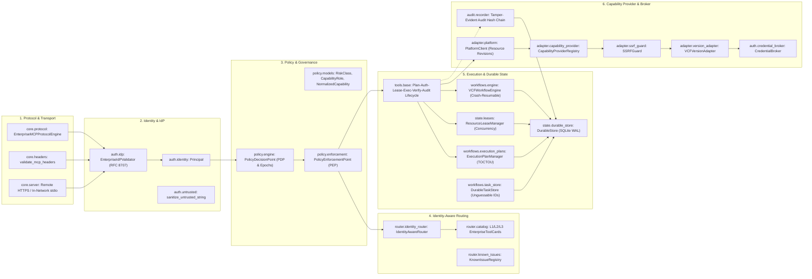
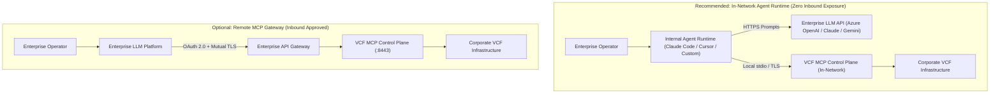
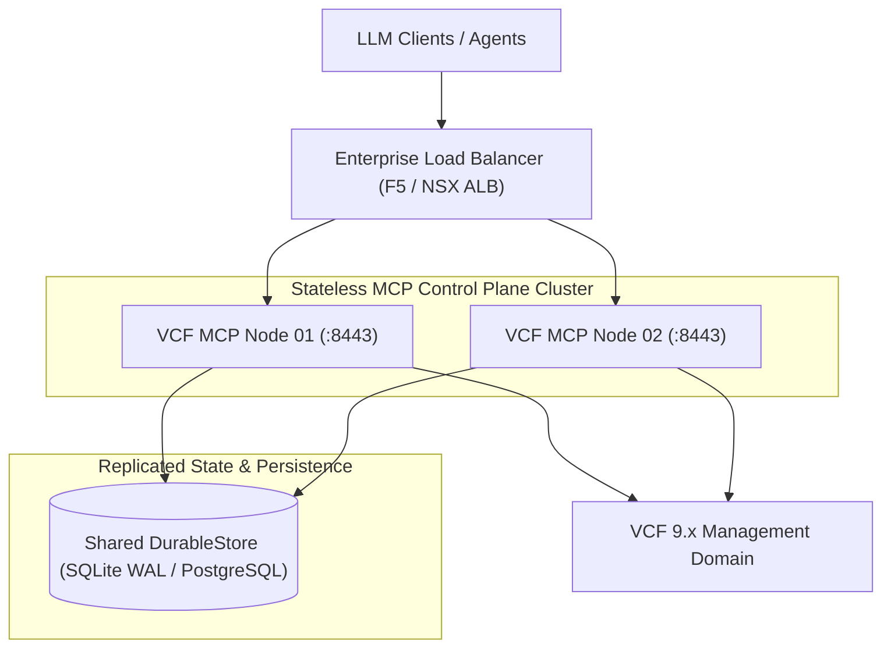
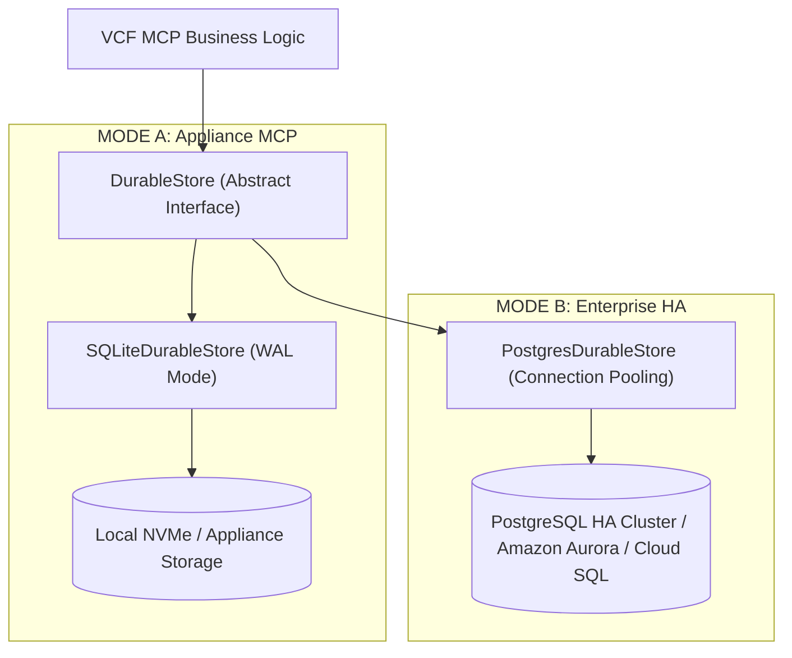
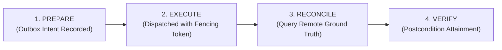
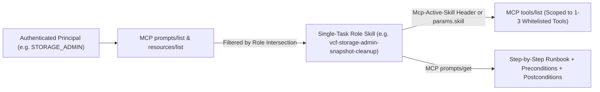
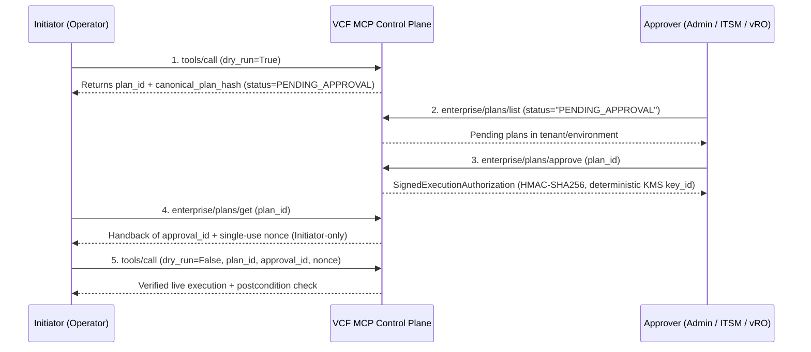

# Enterprise VCF Model Context Protocol (MCP) Control Plane Architecture

This document describes the High-Level Design (HLD), Low-Level Design (LLD), trust boundaries, protocol and security architecture of the **Enterprise VCF MCP Control Plane**. The project is unofficial and under testing; to install and run it, start with the [README quick start](../README.md#quick-start-about-five-minutes) and [guided_setup.md](guided_setup.md). Diagrams that show gateways, load balancers or PostgreSQL clusters are example deployments you build yourself; the project ships no appliance image.

> [!TIP]
> **Interactive Architecture Diagrams (Archify)**:
> Explore the standalone, offline, zero-network interactive technical diagrams with motion, theme controls, and guided lenses in [`docs/interactive_architecture/`](interactive_architecture/index.html):
> - 🌐 **[Master Interactive Architecture Portal](interactive_architecture/index.html)** — Unified executive control center
> - 🏛️ **[1. High-Level Design (HLD) & Trust Boundaries](interactive_architecture/hld_architecture.html)** — Identity, untrusted AI runtime, edge gates & VCF fleet
> - 🧱 **[2. Low-Level Design (LLD) 6-Layer Architecture](interactive_architecture/lld_architecture.html)** — Strict unidirectional module layering
> - 🚀 **[3. Deployment Topologies & High Availability (HA)](interactive_architecture/deployment_topology.html)** — Pattern 1 In-Network vs Pattern 2 Gateway ALB; SQLite vs Postgres HA
> - 🔐 **[4. Two-Stage Auth & TOCTOU-Safe Execution Sequence](interactive_architecture/two_stage_execution.html)** — Scoped discovery, dry-run revision pinning, four-eyes gate & fencing tokens
> - ⚙️ **[5. Deterministic Resumable L3 Workflow Engine](interactive_architecture/resumable_workflow.html)** — Domain upgrade orchestration, DRS evacuations & irreversible saga flash boundary
> - 🔄 **[6. 12-State Engine Lifecycle & 4-Phase Step Reconciliation](interactive_architecture/workflow_lifecycle.html)** — PREPARE -> EXECUTE -> RECONCILE -> VERIFY
> - ⚡ **[7. MCP Tasks Extension & Async Protocol Sequence](interactive_architecture/async_tasks.html)** — Unguessable task IDs, SSE push streams & cancellation compensation
> - 🏢 **[8. VCF Infrastructure Architectural Guide (VI Admin Perspective)](interactive_architecture/vcf_admin_architecture.html)** — Physical & VIP ingress, zero-disk CyberArk PAM, two-stage approval gate & VCF fleet topology
> - 🔄 **[9. VCF Operations Flow (VM Resize Lifecycle)](interactive_architecture/vcf_ops_flow.html)** — End-to-end trace: AI request -> vCenter dry run -> Change ticket approval -> PAM fetch -> vCenter task
>
> 📖 **[Comprehensive VCF Infrastructure Engineer & VI Admin Guide](vcf_admin_guide.md)** — Tailored for VMware Administrators, vRO automations, and change management
>
> *Security & Privacy Note: All interactive artifacts run 100% locally in-browser with inline SVGs and zero remote network requests.*

---

## 1. High-Level Design (HLD) & Trust Boundaries

The Enterprise VCF MCP Control Plane installs beside any existing Broadcom VMware Cloud Foundation (VCF 9.0 or 9.1) environment. It bridges corporate identity providers (Entra ID, Okta, Ping) and enterprise AI runtimes (Claude, OpenAI, Azure OpenAI, Gemini, local 4B models) without ever giving the LLM direct access to VCF credentials or raw infrastructure APIs.

```mermaid
graph TD
    User["Enterprise User / Operator"] -->|Corporate SSO / OIDC| IdP["Corporate IdP (Entra ID / Okta / Ping)"]
    IdP -->|Identity Token / Claims| ControlPlane["VCF MCP CONTROL PLANE"]

    subgraph LLM_Boundary ["Outside Trust Boundary (Untrusted Runtime)"]
        LLM["Enterprise AI / LLM Runtime (Claude / OpenAI / Gemini / On-prem Gemma)"]
        LLM -->|MCP 2026-07-28 Protocol (JSON-RPC 2.0 / Headers / TraceContext)| ControlPlane
    end

    subgraph ControlPlane ["VCF MCP Control Plane (Stateless Edge + Durable State)"]
        AuthGateway["Auth Gateway & IdP Token Validator (RFC 8707)"]
        UntrustedSanitizer["Prompt Injection & Untrusted Data Sanitizer"]
        PEP_PreRoute["Stage 1: Pre-Routing PEP (cacheScope=private, TTL=60s)"]
        PDP["Policy Decision Point (PDP: Capability Matrix & Epoch Check)"]
        Router["Identity-Aware 5-Stage Tool Router (Hard-Negative Suppression)"]
        PEP_Exec["Stage 2: Pre-Execution PEP (Scope, Change Window, Four-Eyes Gate)"]
        PlanMgr["Execution Plan & TOCTOU Manager (Monotonic Revisions)"]
        LeaseMgr["Resource Lease Manager (Distributed Mutual Exclusion)"]
        Workflow["Deterministic VCF Resumable Workflow Engine"]
        
        subgraph DurableState ["Durable Control Plane State (SQLite WAL)"]
            DStore[("DurableStore: Tasks, Plans, Leases, Idempotency, Epochs, Hash-Chained Audit")]
        end
        
        Platform["PlatformClient & CapabilityProviderRegistry"]
        SSRFGuard["SSRF & Network Guard (RFC 1918 / Cloud Metadata Block)"]
        Adapter["VCF Version Adapter (9.0.0 → 9.1.1)"]
        Broker["Zero-Trust Credential Broker (JIT Delegation / Vault)"]
    end

    subgraph Downstream_VCF ["Broadcom VCF 9.x Infrastructure Control Plane"]
        SDDC["SDDC Manager LCM (/v1/*)"]
        vCenter["vCenter & Supervisor (/api/vcenter/*)"]
        NSX["NSX Policy & DFW (/policy/api/v1/*)"]
        Ops["VCF Operations (/suite-api/*)"]
        vSAN["vSAN ESA Data Protection (/api/vsan/*)"]
        SRM["Site Recovery & Replication (/api/srm/*)"]
    end

    AuthGateway --> UntrustedSanitizer
    UntrustedSanitizer --> PEP_PreRoute
    PEP_PreRoute --> PDP
    PDP --> Router
    Router --> PEP_Exec
    PEP_Exec --> PlanMgr
    PlanMgr --> LeaseMgr
    LeaseMgr --> Workflow
    Workflow --> DStore
    PlanMgr --> DStore
    LeaseMgr --> DStore
    PEP_Exec --> Platform
    Platform --> SSRFGuard
    SSRFGuard --> Adapter
    Adapter --> Broker
    Broker --> SDDC & vCenter & NSX & Ops & vSAN & SRM
    Workflow -.-> DStore
```

### The Fundamental Security Boundary
The LLM sits strictly **outside** the infrastructure trust boundary:
* **The LLM NEVER receives**: VCF administrative passwords, vCenter sessions, NSX credentials, service-account API keys, OAuth refresh tokens, private SSL certificates, or raw kubeconfigs.
* **The LLM ONLY receives**: Principal-authorized MCP tools, sanitized output schemas, dry-run execution plans, and asynchronous task tracking handles (`taskId`).
* **Untrusted Infrastructure Data**: Infrastructure-originating strings (VM names, cluster annotations, alarm messages) are treated as untrusted data and sanitized to neutralize prompt injection payloads (e.g. `[INJECTION_ATTEMPT_DEFUSED]`).
* **Multi-Level Data Classification**: Payloads are classified across 5 tiers (`PUBLIC`, `INTERNAL`, `CONFIDENTIAL`, `SECRET`, `CREDENTIAL`). Passwords, tokens, private keys, and session cookies are replaced with `[REDACTED]` or secure references (`vault://credentials/...`).

---

## 2. Low-Level Design (LLD) & Strict Layering

The codebase enforces strict unidirectional dependency layering:
`Presentation / Protocol -> Authentication -> Policy Decision / Enforcement -> Router -> Tools -> Workflows / State -> Capability Provider / Adapter -> Credential Broker -> Audit`.



---

## 3. Provider-Neutral MCP 2026-07-28 Standard

The control plane implements the finalized **MCP 2026-07-28** specification:
1. **Stateless Edge + Durable State**: in HTTP mode (`vcf-mcp server --mode http`) the endpoint is `/mcp` on plain HTTP (`server.host`:`server.port`); put a TLS gateway in front of it, for example `https://vcf-mcp.company.com/mcp`. Requests need no session affinity. All state (tasks, approvals, idempotency records, leases, permission epochs) resides in high-durability storage (`DurableStore`).
2. **Tasks Extension Protocol**: 
   - `tasks/list` is **DELIBERATELY REMOVED** per the 2026-07-28 specification to protect operational privacy and prevent cross-principal resource enumeration.
   - Full lifecycle management is provided through `tasks/get`, `tasks/update`, `tasks/cancel`, and `subscriptions/listen` (`notifications/tasks/*`).
   - Task IDs are high-entropy, cryptographically unguessable strings (`task-<24 byte urlsafe string>`).
3. **Private Dynamic Discovery**: The `tools/list` response returns `cacheScope: "private"` and `cacheTtl: 60` to enforce personalized, principal-scoped tool visibility without cache pollution.
4. **Header / Body Agreement**: Validates matching metadata across HTTP headers (`Mcp-Method`, `Mcp-Name`, `Mcp-Param-*`) and JSON-RPC body, alongside W3C `TraceContext` (`traceparent`).
5. **JSON Schema 2020-12**: All tool inputs and outputs strictly follow schema standards without ambiguous multi-type unions.

---

## 4. Dual Enterprise Deployment Patterns



### Pattern 1: In-Network Agent Runtime (Recommended)
* The external LLM provider never establishes inbound network connections into the corporate datacenter.
* The internal agent process prompts the LLM API and executes MCP tools locally over `stdio` or internal TLS.

### Pattern 2: Remote MCP Gateway
* For enterprise LLM platforms with native remote MCP client support.
* Fronted by an enterprise API gateway enforcing OAuth 2.0, IP allowlisting, and mutual TLS (mTLS).

---

## 5. High Availability & Scalability Architecture



Because MCP 2026-07-28 protocol edge is completely stateless, requests can be dynamically routed to any active MCP control plane node. Long-running asynchronous operations persist task states, execution plans, leases, and audit logs to shared storage, enabling seamless zero-downtime rolling upgrades and automatic workflow resumption following node restarts.

---

## 6. Dual Storage Profiles (MODE A vs MODE B)

To satisfy both single-appliance edge requirements and multi-node enterprise HA environments, the control plane establishes an abstract `DurableStore` interface with two pluggable implementations:



* **MODE A (Appliance MCP)**: Single-VM appliance deployment using SQLite with Write-Ahead Logging (`WAL`), zero-configuration, and in-process thread locking.
* **MODE B (Enterprise HA)**: Multi-node load-balanced deployment backed by PostgreSQL HA with row-level locks (`SELECT FOR UPDATE`), outbox state replication, and cross-node coordination.

---

## 7. Distributed Leases with Monotonically Increasing Fencing Tokens

To eliminate split-brain hazards and network partition races, every lease acquisition or extension increments a monotonic `fencing_token`:

```
ResourceLease {
    resource_id: "vm-102",
    owner: "worker-node-02",
    fencing_token: 189,
    expires_at: 1745000120.0
}
```

* If Node A's lease expires during a network partition and Node B acquires `fencing_token = 189`, any delayed operation from Node A carrying `fencing_token = 188` is rejected with `StaleFencingTokenException` (`-32012`).

---

## 8. 4-Phase Step Lifecycle & Native-Operation Reconciliation

Every mutating workflow step executes through a 4-phase lifecycle to handle asynchronous timeouts and remote state ambiguity:



1. **PREPARE**: Records execution intent outbox entry in durable storage:
   `{ "step": "resize_vm", "state": "EXECUTION_INTENT_RECORDED", "target": "vm-102", "desired_state": {"memory_gb": 64}, "fencing_token": 189 }`
2. **EXECUTE**: Dispatches request to downstream VCF provider carrying the fencing token.
3. **RECONCILE**: If a network timeout or connection reset occurs mid-flight:
   - **YES** (Desired state present on VCF) $\rightarrow$ Mark resolved, proceed to VERIFY.
   - **NO** (Clean failure, mutation absent) $\rightarrow$ Safe retry or controlled failure.
   - **UNKNOWN** (Ambiguous remote state) $\rightarrow$ Transition to `RECONCILIATION_REQUIRED` or `MANUAL_INTERVENTION_REQUIRED`.
4. **VERIFY**: Confirms target entity reached desired postcondition.

---

## 9. Extended Workflow States & Irreversible Saga Boundaries

### First-Class Workflow States
The engine avoids binary success/failure simplifications by supporting 12 explicit states:
`PLANNED`, `APPROVAL_PENDING`, `EXECUTING`, `VERIFYING`, `SUCCEEDED`, `FAILED`, `COMPENSATING`, `COMPENSATED`, `RECONCILIATION_REQUIRED`, `CANCEL_REQUESTED`, `CANCELLED`, `MANUAL_INTERVENTION_REQUIRED`.

### Irreversible Compensation Boundaries
Workflows explicitly distinguish compensable steps from irreversible transitions:
* **Compensable Steps**: e.g., Prechecks, bundle downloads, DRS VM evacuations. (Reversible via automated rollback).
* **IRREVERSIBLE BOUNDARY**: e.g., ESXi hypervisor flash, server firmware update. (Cannot be rolled back).
* **Forward Recovery Steps**: Post-boundary steps require forward remediation rather than rollback.

---

## 10. Provider Precedence, Authority & Circuit Breakers

* **Authoritative vs Observed**: vCenter is marked `authoritative: true` for VM ground truth (priority 100), while VCF Operations is marked `authoritative: false` (priority 50, observed telemetry). Operations saying a VM exists can never override vCenter confirming it was deleted.
* **Per-Provider Circuit Breakers**: Each provider tracks consecutive failures. If NSX returns repeated 503s or timeouts, the circuit trips to `OPEN`, failing over to healthy providers or returning `ProviderUnavailableException` (`NETWORK_CONTROL_PLANE_UNAVAILABLE`) to prevent cascading cluster overload.

---

## 11. Admission Controller & Backpressure

Protects upstream infrastructure from runaway LLM loops and operational stampedes:
* **Principal Budgets**: 300 reads/min, 20 writes/min.
* **Concurrency Budgets**: 1 concurrent domain upgrade, 20 concurrent VM mutations.
* **Component Budgets**: NSX (25 req/sec), vCenter (50 req/sec), SDDC Manager (20 req/sec).
* Exceeding thresholds triggers `RateLimitBudgetExceededException` (`-32017`).

---

## 12. External WORM Audit Anchoring & Supply-Chain Security

* **External Anchoring**: `anchor_audit_chain_head(external_target)` periodically anchors the SHA-256 chain head to external SIEM / WORM storage, preventing history rewriting even if the local database is compromised.
* **Software Supply-Chain Security**: Generates signed CycloneDX 1.5 SBOM manifests documenting component hashes, licenses, and provenance signatures.

---

## 13. Pre-Provided Single-Task Role Skills Architecture (26 Skills)

Rather than exposing a monolithic system prompt or all 50+ tools at once to an LLM agent, `vcf_enterprise_mcp` implements a **Single-Task Role Skills Architecture** (`src/vcf_enterprise_mcp/skills/registry.py` and `.agents/skills/<skill-name>/SKILL.md`). Each skill is bound to a specific VCF `CapabilityRole`, a single operational objective, and a strict tool whitelist (2 to 11 tools; `vcf-mcp skills list` shows each):



### Dual Delivery Channels
1. **IDE / Coding Agent File Skills (`.agents/skills/<skill-name>/SKILL.md`)**: shipped in the repository and re-creatable with `vcf-mcp skills export [--dir <path>]` (default `.agents/skills` in the current directory); agents that read that folder pick them up.
2. **In-Band MCP Protocol (`prompts/list`, `prompts/get`, `resources/list`, `resources/read`, and `tools/list`)**:
   - `prompts/list` and `resources/list` dynamically filter the skills by the caller's `CapabilityRole`.
   - Passing `params: {"skill": "<skill-name>"}` or HTTP header `Mcp-Active-Skill: <skill-name>` to `tools/list` restricts visible tools to that skill's exact `allowed_tools` whitelist intersected with the caller's RBAC entitlements.

---

## 14. In-Band Plan Discovery, Four-Eyes Approval & Initiator Handback

All mutating operations (`SAFE_WRITE`, `CHANGE`, `HIGH_IMPACT`, `DESTRUCTIVE`) require a deterministic dry-run execution plan (`dry_run=True`) with TOCTOU resource revision pinning before live dispatch (`dry_run=False`):



In personal access mode (one person on their own machine, stdio only) the person who asked approves instead, with one confirmation per plan through a chat prompt, a one-time local page or their own terminal; see [authorization_model.md](authorization_model.md#0-access-modes-personal-and-team). In team mode the approver can be a person running `vcf-mcp plans approve <plan_id>` in a terminal with their **own** token (`--approver-token-file` or `VCF_MCP_APPROVER_TOKEN`), or any client that calls `enterprise/plans/approve` with the approver's token. In both cases the approver must differ from the initiator and hold one of the roles `VCF_PLATFORM_ADMIN`, `SECURITY_ADMIN`, `COMPUTE_ADMIN`, `NETWORK_ADMIN` or `LIFECYCLE_ADMIN`; the initiator then pastes the printed `approval_id` and `nonce` into the chat (or reads them via `enterprise/plans/get`).

---

## 15. Developer Laptop & Lab Quickstart Mode

To make testing against the included Digital Twin or a non-production VCF lab effortless from a developer laptop without requiring an external OIDC Identity Provider or HashiCorp Vault:
* **One-Command Lab Bootstrap (`vcf-mcp init-lab`)**: Initializes a persistent local KMS key (`~/.vcf-mcp/kms.key`), stores an encrypted lab credential (`local://prod/sddc-lab`) if you give it a password, writes a lab `config.yaml` (with `idp.allow_lab_tokens: true`), mints Operator and Approver RS256 JWT tokens signed by the lab key (`~/.vcf-mcp/lab_jwt_key.pem`), and prints a ready-to-paste `mcpServers` JSON block. The guided setup (README quick start) is the recommended route; `init-lab` is the shortcut for a lab.
* **Local Role Token Minter (`vcf-mcp token mint --role <ROLE>`)**: Mints RS256 JWT tokens (issuer `urn:vcf-mcp:lab`, valid 24 hours by default) for any of the 16 VCF `CapabilityRole` personas. The server accepts them only with `idp.allow_lab_tokens: true` (or `VCF_MCP_ALLOW_LAB_TOKENS=1`), never in production mode.
* **Lab Self-Approval & Auto-Approval (`VCF_LAB_SELF_APPROVE=true`, `VCF_LAB_AUTO_APPROVE=true`)**: environment switches that let a single engineer on a laptop test the complete two-stage dry-run and signed-plan flow without a second person (blocked when `VCF_MCP_ENV=production`). Leave them off for anything real: the documented way is a second token with `vcf-mcp plans approve`.
