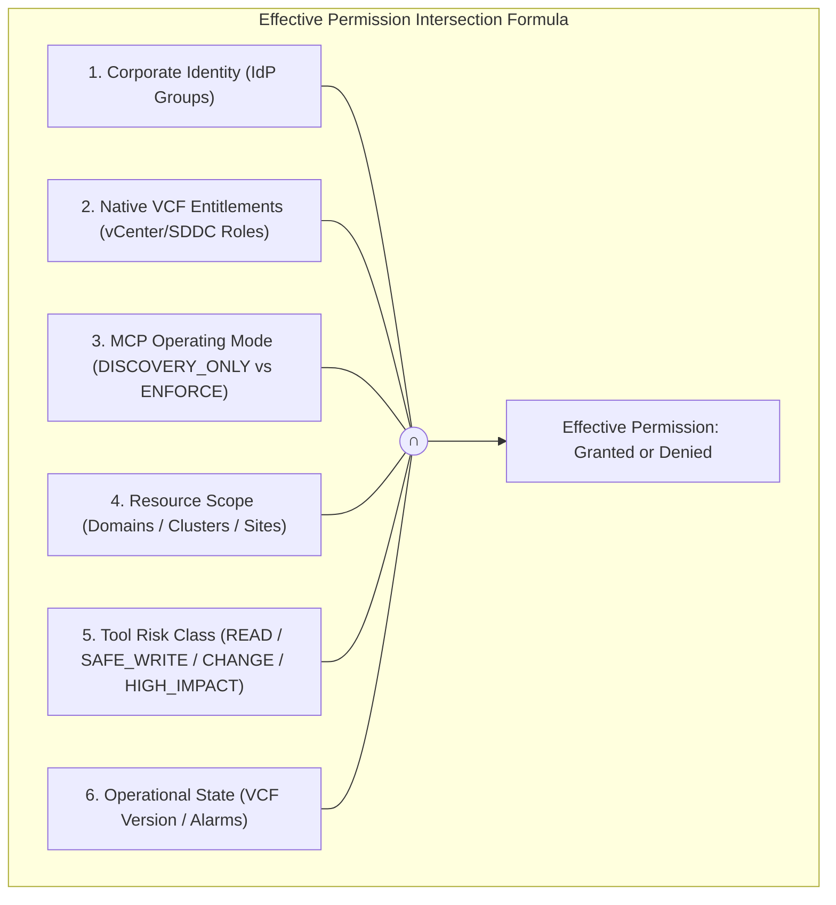
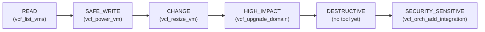
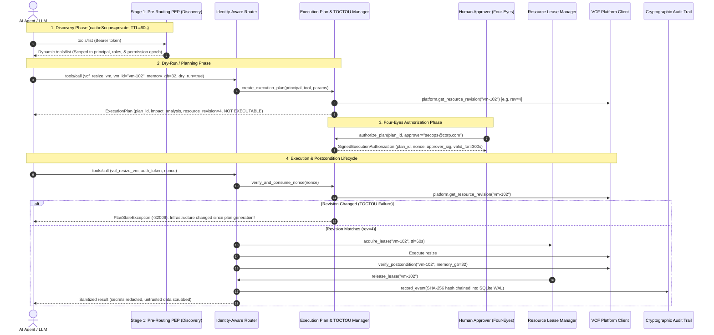

# Enterprise VCF MCP Authorization & Security Model

This document establishes the definitive authorization architecture, permission intersection formulas, restrictive capability role overlays, and risk classification standards for the **Enterprise VCF MCP Control Plane**.

---

## 0. Access modes: personal and team

`server.access_mode` chooses who the caller is and who approves. Everything below (roles, risk classes, the intersection formula, plans, TOCTOU checks, audit) applies in both modes; the modes differ in **identity** and **approval**.

| | **personal** | **team** |
|---|---|---|
| Intended for | one person on their own computer, stdio only | shared labs, production, anything with more than one person |
| Caller identity | the local OS user (`getpass.getuser()` + `@` + short host name, or `server.personal_user`); roles from `server.personal_roles` (starter: `VCF_PLATFORM_ADMIN`, narrowed by guided setup to the roles your goals need, always keeping `MCP_ADMIN`) | the verified user in an identity-provider or lab token, required on every call |
| Token | none needed. If one is supplied it is validated and used | `VCF_MCP_AUTH_TOKEN` (stdio) or `Authorization: Bearer` (HTTP) |
| Who approves | the person who asked: **one explicit human confirmation per plan** | a different person holding an approver role, with their own token |
| Separation of duties | not applicable (there is one person) | initiator may not approve; two different approvers for `DESTRUCTIVE` and `SECURITY_SENSITIVE` |
| Extra human act | for `DESTRUCTIVE` / `SECURITY_SENSITIVE` changes (and tools whose impact is destructive, such as snapshot deletion) the person also types the target name, or the plan's 6-character code when there is no single target | none |
| Approval channels | chat prompt (MCP elicitation), one-time local page, own interactive terminal | `vcf-mcp plans approve` with the approver's token, or the `enterprise/plans/approve` RPC |
| Execution | the assistant calls again with `plan_id` only; the server uses the recorded approval exactly once | the assistant calls again with `plan_id`, `approval_id` and `nonce` |

**Which mode applies.** The key absent means `team`: existing configs, `init-lab`, and the organisation simulator keep their behaviour. Only the starter config written by `vcf-mcp client-config` (or by the first server start) sets `personal`. Personal mode is **refused with a clear error** when more than one person could be involved: `server.mode` is `http` or `remote_gateway` (including `--mode http`), `server.production_mode: true`, `VCF_MCP_ENV=production`, or `server.storage_mode: ENTERPRISE_HA`. A network request never receives the personal identity even if the engine is embedded in a server.

**Why personal mode is safe for one person.** Whoever can start the stdio server as your OS user can already read the lab signing key, the KMS secret and the credential store in the same state folder (`~/.vcf-mcp`), so a signed token proves nothing the file permissions do not already prove, and a "different approver" does not exist on a one-person laptop. What a token and a second approver were really buying here is *a human in the loop between the model and a change*, and personal mode keeps exactly that:

- the model can never approve: the prompt is answered in the client's own UI (`params.inputResponses`, never tool arguments), the page needs a human click in a browser, and the terminal command refuses non-interactive shells (stdin and stdout must be a TTY) and needs the plan's code typed from the screen;
- the plan is still immutable and hash-bound; the approval is KMS-signed, bound to the plan hash, expires with the plan and is used once; arguments that differ from the dry run, stale resource revisions and permission changes are still refused;
- guided setup narrows the roles the assistant acts as, the operator safety profile can still switch tools off, and read-only / `DISCOVERY_ONLY` still hide writes;
- every approval is audited with approver, channel (`in_client`, `page`, `cli`, `token`), mode and plan hash.

**What personal mode does not protect against.** A malicious program running as you, or an assistant with an unrestricted shell on the same machine, could read the same files you can, fetch the local approval page (its link is in the dry-run result) or drive a pseudo-terminal. Personal mode defends against the model acting on its own or being talked into it by injected text; it is not a defence against code running with your privileges. If that matters, use team mode with approvers on a different machine, switch tools off with `vcf-mcp safety`, and keep `policy.operating_mode: DISCOVERY_ONLY` until you need changes.

**When to use team mode.** Anyone else may use the same MCP or the same appliances, the server is reachable over a network, the environment is production, state is shared (`ENTERPRISE_HA`), or an auditor needs a second person on every destructive change.

## 1. The Core Intersection Principle

> **Crucial Rule**: The MCP Control Plane must never replace native VCF RBAC. It acts strictly as an **intersecting, restrictive overlay**. The control plane can only reduce or scope permissions; it must **never** enlarge what native VCF grants.

### Effective Permission Formula
$$\text{Effective Permission} = \text{Corporate IdP} \cap \text{Native VCF Entitlement} \cap \text{MCP Mode} \cap \text{Resource Scope} \cap \text{Risk Policy} \cap \text{Operational State}$$

### Real-World Evaluation Example
* **User**: `alice@corp.com`
* **Corporate Groups**: `VCF-Compute-Operators`, `VCF-Prod-ReadOnly`
* **Derived Capability Roles**: `COMPUTE_OPERATOR`, `VCF_VIEWER`
* **Permitted Scope**: `Cluster-PROD-A` on `wld-app-a`
* **Evaluation Matrix**:

| Operation Requested | Target Resource | Authorization Outcome | Reason |
|---|---|---|---|
| `vcf_list_vms` | `Cluster-PROD-A` | **ALLOW** | `VCF_VIEWER` role permits READ in authorized scope. |
| `vcf_resize_vm(mem=32GB)` | `Cluster-PROD-A` | **ALLOW** | `COMPUTE_OPERATOR` role permits CHANGE in authorized scope. |
| `vcf_resize_vm(mem=32GB)` | `Cluster-PROD-B` | **DENY** | Resource scope boundary violation (`Cluster-PROD-B` is outside Alice's scope). |
| `vcf_create_nsx_segment` | `Cluster-PROD-A` | **DENY** | Missing required role (`NETWORK_ADMIN`). |
| `vcf_upgrade_domain` | `wld-app-a` | **DENY** | Missing required role (`LIFECYCLE_ADMIN`). |
| `vcf_orch_add_integration` | Orchestrator | **DENY** | Missing required role (`SECURITY_ADMIN`; the tool is SECURITY_SENSITIVE and needs two approvers). |

---

## 2. Restrictive Overlay Capability Roles

The control plane defines 16 granular capability roles:

| Capability Role | Operational Scope & Capabilities | Maximum Permitted Risk |
|---|---|---|
| `VCF_VIEWER` | Read-only inventory, health, alerts, and performance metrics. | `READ` |
| `VCF_AUDITOR` | Compliance checks, configuration history, audit logs, and security baselines. | `READ` |
| `COMPUTE_OPERATOR` | VM power states, snapshot creation, and non-destructive memory/CPU resize. | `CHANGE` |
| `COMPUTE_ADMIN` | VM provisioning, deletion, vMotion migrations, and VM class assignments. | `HIGH_IMPACT` |
| `NETWORK_OPERATOR` | Read NSX topology, inspect BGP peering status, trace network flows. | `READ` |
| `NETWORK_ADMIN` | Tier-0 / Tier-1 gateway provisioning, overlay segments, DFW firewall rules. | `HIGH_IMPACT` |
| `STORAGE_OPERATOR` | Storage capacity monitoring, policy compliance, and vSAN health alerts. | `READ` |
| `STORAGE_ADMIN` | vSAN ESA lifecycle, snapshot protection groups, and linked clones. | `HIGH_IMPACT` |
| `AUTOMATION_OPERATOR`| Cloud Assembly deployments, project discovery, and vRO workflow runs. | `CHANGE` |
| `DR_OPERATOR` | Disaster recovery drill evaluation and non-disruptive test bubble runs. | `SAFE_WRITE` |
| `DR_ADMIN` | Production site recovery failover, migration, and reprotect execution. | `HIGH_IMPACT` |
| `LIFECYCLE_OPERATOR` | Software bundle downloads, update pre-checks, and manifest validation. | `READ` |
| `LIFECYCLE_ADMIN` | Workload domain upgrades, patch orchestration, host commissioning. | `HIGH_IMPACT` |
| `SECURITY_ADMIN` | SSL certificate renewals, CSR generation, and SSO Realm configurations. | `SECURITY_SENSITIVE` |
| `VCF_PLATFORM_ADMIN` | Full infrastructure management overlay across all domains. | `DESTRUCTIVE` |
| `MCP_ADMIN` | Control plane operational settings, log levels, and IdP mapping only. | `SAFE_WRITE` |

---

## 3. Operational Risk Classes

Every MCP tool carries a mandatory, immutable risk classification:

1. **READ**: Non-mutating inventory, telemetry, and log inspection. Zero operational risk.
2. **SAFE_WRITE**: Reversible, non-disruptive actions (e.g., turning on an existing VM, taking a test snapshot).
3. **CHANGE**: Standard infrastructure modifications (e.g., resizing VM memory, creating a network segment).
4. **HIGH_IMPACT**: Multi-node or domain-wide impact (e.g., domain upgrade, site failover). **Requires human approval**.
5. **DESTRUCTIVE**: Irreversible data loss or host decommissioning. **Team mode: dual authorization. Personal mode: your confirmation plus the typed target.**
6. **SECURITY_SENSITIVE**: Cryptographic certificates, credentials, SSO identity bindings and Orchestrator integrations. Guided setup (`vcf_setup`) is *not* gated by an approval: it needs the `MCP_ADMIN` or `VCF_PLATFORM_ADMIN` role and runs without a dry run or plan.

---

## 4. Two-Stage Authorization Architecture & Execution Lifecycle

### Stage 1: Pre-Routing / Discovery Authorization
* The `tools/list` endpoint is **principal-sensitive** and isolated using HTTP `cacheScope: "private"`.
* Bumping the `permission_epoch` for a tenant immediately invalidates all active tool lists and authorization caches.
* A Network Administrator never sees VM resize or snapshot tools.
* A Compute Operator never sees NSX gateway or DFW rule tools.
* An Auditor only sees read-only tools.
* **Benefits**: Prevents internal infrastructure enumeration and eliminates LLM hallucination across unpermitted tools.

### Stage 2: Pre-Execution Object Authorization & TOCTOU Defense
* **Dry-Run Planning**: Calling a mutating tool with `dry_run=true` produces an immutable `ExecutionPlan` recording current resource revisions (`resource_revision`) and simulated impacts. It does **not** grant an executable execution token.
* **Four-Eyes Separation of Duties** (team mode; personal mode uses one human confirmation, section 0): The user who requests a change cannot approve their own plan. An authorized approver signs a `SignedExecutionAuthorization` bound to a single-use high-entropy `nonce`.
* **TOCTOU Recheck**: Prior to mutating live infrastructure, the control plane checks `platform.get_resource_revision()`. If the resource changed since the plan was minted, execution aborts immediately with `PlanStaleException`.
* **Mutual Exclusion Leases**: `ResourceLeaseManager` acquires an exclusive lock on the target entity (`vm_id`, `cluster_id`, `domain_id`) with TTL and heartbeat to prevent concurrent conflicting mutations.
* **Postcondition Verification**: Once executed, the control plane verifies that the resource genuinely reached the desired state (e.g. RAM == 32GB). If not, it raises `PostconditionFailedException` and records an incident.
* **Tamper-Evident Audit Trail**: Every event is cryptographically hash-chained (`SHA-256(prev_hash + current_event)`) into durable SQLite WAL storage.

---

## 5. Invariant Security Boundary: `tools/list` vs `tools/call`

* **`tools/list` = UX, Security Minimization & Routing Optimization**: Pruning tools reduces prompt size, prevents unprivileged resource enumeration, and guides the LLM away from unpermitted operations.
* **`tools/call` = The Permanent Invariant Security Boundary**: Even if an adversary manually injects a call to `{"name": "vcf_upgrade_domain"}` without having seen it in `tools/list`, the Policy Enforcement Point (PEP) immediately subjects the request to the full 6-way mathematical intersection. Unprivileged or out-of-scope calls are unconditionally rejected.

---

## 6. Canonical Plan Hashing & Rotatable KMS Signatures

Execution plans bind all operational context into a tamper-proof canonical digest:
$$\text{Canonical Hash} = \text{SHA256}\left(\text{canonical\_json}(\text{tenant}, \text{env}, \text{principal}, \text{tool}, \text{resources}, \text{arguments}, \text{revisions}, \text{epoch}, \text{risk}, \text{expiry})\right)$$

The resulting digest is signed via an external Key Management Service / HSM:
* **Rotatable KMS Keys**: Signatures include `key_id`, `algorithm` (HMAC-SHA256 / RSA-PSS), and `signature_version`.
* **Key Rotation Resilience**: When active keys rotate, historical keys remain registered in the KMS store so audit records and unexpired plans remain verifiable.

---

## 7. Configurable Multi-Person Approval Policy (`ApprovalPolicy`)

Rather than a hardcoded single-approver check, high-impact operations enforce an enterprise `ApprovalPolicy`:

| Risk Class | Required Independent Approvers | Permitted Approver Roles |
|---|---|---|
| `READ` | 0 | Public / Viewer |
| `SAFE_WRITE` | 0 | Compute Operator |
| `CHANGE` | 1 | Compute Operator / Admin |
| `HIGH_IMPACT` | 1 | VCF-Platform-Admins, VCF-Lifecycle-Admins |
| `DESTRUCTIVE` | 2 | VCF-Platform-Admins, VCF-Security-Admins |
| `SECURITY_SENSITIVE`| 2 | VCF-Security-Admins |

* **Separation of Duties** (team mode): The plan initiator is strictly barred from approving their own plan (`initiator != approver`). In personal mode the policy is replaced by one confirmation from the local person (section 0).

---

## 8. Fine-Grained Permission Epochs

To avoid coarse-grained cache invalidations where modifying Alice's role invalidates all users in the environment, the control plane enforces a 3-tier epoch hierarchy:
1. `environment_epoch`: Bumps on datacenter-wide maintenance mode or global security posture changes. Invalidates all active catalogs.
2. `principal_epoch`: Bumps when an individual user's group or role assignment changes. Invalidates only that user's cached decisions and outstanding approval nonces.
3. `policy_epoch`: Bumps when organizational rule overlays or risk classes are updated.

$$\text{Effective Cache Key} = \text{tenant} + \text{environment} + \text{principal} + \text{env\_epoch} + \text{principal\_epoch} + \text{policy\_epoch}$$

