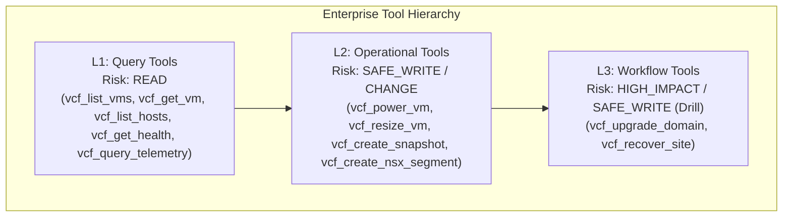

# MCP Protocol & Tool Catalogue Specification (MCP 2026-07-28)

This document establishes the technical protocol specifications, tool level taxonomy, Tasks extension endpoints, and error handling contracts for the **Enterprise VCF MCP Control Plane**.

---

## 1. Protocol Architecture & Standards

* **Protocol Revision**: `2026-07-28` (Stateless JSON-RPC 2.0 Edge + Durable State).
* **Schema Standard**: JSON Schema `2020-12`.
* **Transport**: Remote HTTPS / SSE (`https://vcf-mcp.company.com/mcp`) and In-Network standard I/O (`stdio`).
* **Authentication**: Enterprise-Managed Authorization via HTTP `Authorization: Bearer <corporate-jwt>` (RFC 8707 Resource Indicators).
* **Discovery Isolation**: `tools/list` returns `cacheScope: "private"` and `cacheTtl: 60` to enforce principal-scoped tool visibility without shared-cache leakage.
* **Header / Body Agreement**: Validates `Mcp-Method`, `Mcp-Name`, and `Mcp-Param-*` headers against JSON-RPC payload alongside W3C `traceparent`.
* **Asynchronous Execution**: Native MCP Tasks Extension (`tasks/get`, `tasks/update`, `tasks/cancel`, `subscriptions/listen`).
  - **Important**: `tasks/list` is **DELIBERATELY REMOVED** in MCP 2026-07-28 to prevent unprivileged cross-principal enumeration. Calls to `tasks/list` return `-32601 Method not found`.

---

## 2. Three-Level Tool Hierarchy

To optimize reasoning for both frontier LLMs and sub-4B compact models, enterprise tools are organized into three distinct tiers:



### Level 1: Query Tools (Low Risk, READ)
* **Characteristics**: Idempotent, non-mutating, zero impact on running workloads.
* **Tools**:
  * `vcf_list_vms`: Lists virtual machines in clusters with power states and resource allocations.
  * `vcf_get_vm`: Returns detailed hardware, disks, and network interface IP addresses for a VM.
  * `vcf_list_hosts`: Lists physical commissioned ESXi hypervisor hosts across clusters.
  * `vcf_get_health`: Returns consolidated subsystem health status and active alarms.
  * `vcf_query_telemetry`: Reads recent metric samples for an entity from VCF Operations (`GET /suite-api/api/resources/{id}/stats`).

### Level 2: Operational Tools (Moderate Risk, SAFE_WRITE / CHANGE)
* **Characteristics**: Reversible single-entity mutations. Every mutating tool **must** support `dry_run: true`.
  - Calling with `dry_run: true` creates an `ExecutionPlan` with resource impact analysis. It does **not** grant an executable execution token.
  - Live execution requires an approver-signed `SignedExecutionAuthorization` with a single-use `nonce`.
* **Tools**:
  * `vcf_power_vm`: Changes VM power state (`start`, `stop`, `restart`, `suspend`).
  * `vcf_resize_vm`: Modifies assigned RAM (GB) or vCPU core count.
  * `vcf_create_snapshot`: Generates local or immutable vSAN point-in-time recovery snapshots.
  * `vcf_create_nsx_segment`: Provisions logical overlay network segments on Tier-1 gateways.

### Level 3: Deterministic Workflow Tools (High Impact, Orchestrated)
* **Characteristics**: Multi-step procedures orchestrated deterministically by the control plane rather than manual LLM chaining. Asynchronous execution returns an unguessable `taskId` handle. Includes compensation boundaries and automatic crash recovery resumption.
* **Tools**:
  * `vcf_upgrade_domain`: Orchestrates complete workload domain upgrades with manifest checks, known vendor issue screening, pre-checks, impact plan generation, and approval gates.
  * `vcf_recover_site`: Orchestrates disaster recovery drills in isolated test bubble networks.

---

## 3. MCP Tasks Extension Contract

Long-running workflows execute asynchronously to prevent transport timeouts. Clients interact with tasks via standard JSON-RPC 2.0 methods:

### `tasks/get` Request
```json
{
  "jsonrpc": "2.0",
  "id": 100,
  "method": "tasks/get",
  "params": {
    "taskId": "task-861f5e234b981ca290f1"
  }
}
```

### `tasks/get` Response
```json
{
  "jsonrpc": "2.0",
  "id": 100,
  "result": {
    "taskId": "task-861f5e234b981ca290f1",
    "tool": "vcf_upgrade_domain",
    "initiator": "admin@corp.com",
    "status": "RUNNING",
    "progress": 33.33,
    "step": "2/6: Upgrading ESXi host transport nodes",
    "approvalStatus": "APPROVED",
    "impact": {
      "affected_hosts": 8,
      "affected_vms": 64,
      "domain_id": "wld-app-a"
    },
    "createdAt": 1745000000.0,
    "updatedAt": 1745000120.0
  }
}
```

### `subscriptions/listen` Request
```json
{
  "jsonrpc": "2.0",
  "id": 101,
  "method": "subscriptions/listen",
  "params": {
    "events": ["notifications/tasks/*", "notifications/tools/list_changed"]
  }
}
```

### Tasks Extension Opt-In Conformance
In accordance with the MCP Tasks extension specification:
* **Opt-In Mandate**: A task handle is materialized **only** when the client explicitly advertises opt-in via `io.modelcontextprotocol/tasks` on that request.
* **Standard Call**: If the client calls `tools/call` without the extension flag, the operation executes synchronously (or returns direct status) and does not force the client into task polling.
* **Access Control**: `tasks/get`, `tasks/update`, and `tasks/cancel` enforce ownership; callers cannot inspect or mutate tasks created by other principals.

---

## 4. Standard Error Codes

| JSON-RPC Error Code | Exception Type | Description |
|---|---|---|
| `-32001` | `AuthorizationDeniedException` | Denied by Policy Decision Point (PDP) intersection (role, scope, mode). |
| `-32002` | `ApprovalRequiredException` | High-impact operation requires human approval prior to live execution. |
| `-32003` | `VersionMismatchException` | Feature not available on the active VCF release baseline. |
| `-32004` | `WorkflowExecutionException` | A deterministic step in an L3 workflow failed. |
| `-32005` | `SSRFViolationException` | Request probed an unauthorized IP range or cloud metadata endpoint. |
| `-32006` | `PlanStaleException` | TOCTOU guard: Resource revision changed between planning and execution. |
| `-32007` | `IdempotencyConflictException` | Idempotency key reused with divergent payload parameters. |
| `-32008` | `PostconditionFailedException` | Target resource state did not achieve verified state after execution. |
| `-32009` | `HeaderMismatchException` | HTTP `Mcp-*` headers do not agree with the JSON-RPC body. |
| `-32010` | `TaskNotFoundException` | Specified `taskId` does not exist in durable task storage. |
| `-32011` | `CapabilityNotFoundException` | Requested capability not registered in environment. |
| `-32012` | `StaleFencingTokenException` | Monotonic fencing token superseded by subsequent lease acquisition. |
| `-32013` | `ReconciliationRequiredException` | Ambiguous remote state after network drop requires outbox reconciliation. |
| `-32014` | `ManualInterventionRequiredException`| Automated reconciliation cannot resolve remote state safely. |
| `-32015` | `ResourceLockException` | Target resource is locked under an active lease by another worker. |
| `-32016` | `ProviderUnavailableException` | Upstream provider circuit breaker is OPEN. |
| `-32017` | `RateLimitBudgetExceededException`| Principal rate limit or component concurrency budget exceeded. |
| `-32601` | `MethodNotFound` | Unknown JSON-RPC method (also returned for removed `tasks/list`). |
| `-32602` | `InvalidParams` | Missing required parameters or invalid schema. |
| `-32603` | `InternalError` | Unhandled internal exception. |

## Local remediation update (2026-09-27)

HTTP metadata is mandatory at the gateway; errors use `-32020` for header mismatch
and `-32022` for unsupported versions. All mutations require signed plans, including
SAFE_WRITE. The authenticated enterprise extension `enterprise/plans/approve`
accepts `params.plan_id` and returns authorization credentials to a separate platform
administrator. It is tenant/environment scoped and unavailable in read-only modes.
See [the current local testing guide](local_testing.md) for request details and
qualification limits. The earlier transport/Tasks descriptions above are design
claims, not evidence of complete 2026-07-28 conformance; streaming/subscriptions and
native VCF qualification remain outside the local remediation test scope.
