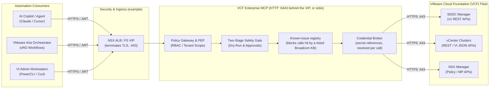
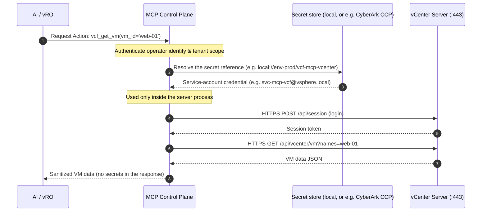
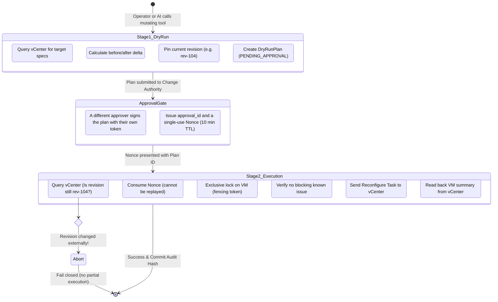
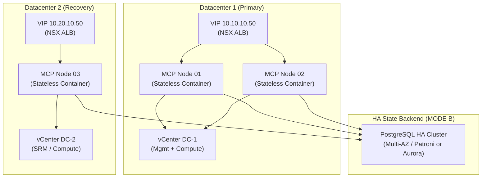

# VCF Infrastructure Engineer & VI Admin Guide
## Enterprise Model Context Protocol (MCP) Control Plane for VMware Cloud Foundation (VCF)

> **Unofficial project, under testing.** Everything here was exercised against simulators only, not a live VCF fleet; use it in a lab. Installation and first use are in the [README quick start](../README.md#quick-start-about-five-minutes) and [guided_setup.md](guided_setup.md). This guide explains the design for VMware administrators. Where it shows a topology (load balancer, PAM vault, PostgreSQL), that is an example of how you could run it, not something the project installs for you.

This document is written for **VMware Administrators, Infrastructure Engineers, and VCF Architects**. It explains how the Enterprise VCF MCP Control Plane functions, how it connects to your VCF fleet, how it protects infrastructure from unintended AI actions, and how another client such as **VMware Aria Orchestrator (vRO)** can call it. There is no built-in ServiceNow or Jira integration: an approval process of your own can call the approval step described below.

> [!TIP]
> **Explore Interactive Technical Diagrams (Archify)**:
> Standalone, zero-network, interactive HTML diagrams with animation and guided lenses are available in the local documentation portal:
> - 🏛️ **[Interactive VI Admin Architecture Map](interactive_architecture/vcf_admin_architecture.html)**
> - 🔄 **[Interactive Infrastructure Operation Lifecycle Flow](interactive_architecture/vcf_ops_flow.html)**
> - 🌐 **[Master Interactive Architecture Portal](interactive_architecture/index.html)**

---

## 1. What is Enterprise VCF MCP? (The VI Admin Elevator Pitch)

As a VMware engineer, you are accustomed to managing vCenter, NSX, and SDDC Manager via the vSphere Client, PowerCLI scripts, or vRealize Orchestrator (vRO) workflows.

When organizations introduce AI Assistants (like Claude, Cursor, or internal enterprise agents) to automate infrastructure tasks, **giving an AI raw API tokens or root vCenter credentials is an unacceptable risk**. An AI might hallucinate an argument, run uncoordinated parallel tasks, bypass change windows, or trigger a known ESXi bug.

The **Enterprise VCF MCP Control Plane** is an API proxy and safety broker that sits between your automation consumers (AI models, vRO workflows, operator scripts) and your VMware Cloud Foundation environment:



### Key Guarantees for VI Admins
1. **No passwords in the model or in the config**: the AI never sees vCenter, NSX, or SDDC Manager passwords. `config.yaml` holds only secret *references*. By default the passwords themselves are in a local encrypted store (`~/.vcf-mcp/credentials.json`, encrypted with a key file next to it, mode 0600); you can instead point a reference at your own vault (HashiCorp Vault, Azure Key Vault, AWS Secrets Manager or CyberArk CCP), in which case nothing is stored on the MCP host and the secret is fetched when needed.
2. **No Blind Mutations (Dry-Run First)**: An AI cannot execute a mutating action directly. It must first create a **Dry-Run Plan** computing the exact diff.
3. **Four-Eyes Approval**: every write (VM power, resize, snapshot, NSX segment, upgrade, Orchestrator saves and runs ...) needs a signed approval from a different human who holds an approver role, using their own token. Destructive and security-sensitive plans need two different approvers. There is no built-in change-window or ServiceNow check; an approver can be your own workflow calling the approval step with that person's token.
4. **TOCTOU Collision Protection**: If a human admin modifies a VM in the vSphere Client while the AI is planning a change, MCP detects the state drift and aborts the execution to prevent split-brain collisions.
5. **Postcondition Verification**: MCP does not treat an HTTP 200 response as success. For VM changes it reads the resulting hardware state back from vCenter before reporting completion.

---

## 2. Infrastructure Architecture & Network Matrix

From a networking perspective, VCF Enterprise MCP is a Python service you run on a host in your management network. A harness on the same host uses stdio and opens no port. For remote clients you run `vcf-mcp server --mode http` behind your existing load balancer (for example NSX Advanced Load Balancer / Avi Vantage, or F5 BIG-IP) and share one durable store (PostgreSQL) between nodes if you run more than one. The project ships no appliance image.

### Network & Port Requirements (Firewall Rules)

| Source | Destination | Port | Protocol | Description |
| :--- | :--- | :--- | :--- | :--- |
| AI Clients / vRO / Admins | NSX ALB / F5 VIP | `443` | HTTPS | Client ingress via MCP 2026-07-28 protocol; TLS ends here |
| NSX ALB / F5 VIP | MCP nodes | `8443` (`server.port`) | HTTP | Endpoint `/mcp`. The MCP's own listener is plain HTTP and has no TLS option, so keep this hop on a trusted network or use a gateway that re-encrypts |
| MCP nodes | Corporate IdP (Entra/Okta) | `443` | HTTPS | OIDC / JWKS token signature validation |
| MCP nodes | Secret vault (only if you use one: CyberArk CCP, HashiCorp Vault, Azure Key Vault, AWS Secrets Manager) | `443` | HTTPS | Credential retrieval by reference |
| MCP nodes | SDDC Manager | `443` | HTTPS | Workload domain provisioning & LCM APIs |
| MCP nodes | Management / Compute vCenters | `443` | HTTPS | VM lifecycle, host, cluster APIs |
| MCP nodes | NSX Manager Cluster VIP | `443` | HTTPS | Segments, Tier-0/1 gateways, security policies |
| MCP nodes | VCF Operations (and VCF Automation / Orchestrator if configured) | `443` | HTTPS | Health, alerts, telemetry; templates and workflows |
| MCP nodes | PostgreSQL HA Cluster *(Optional)* | `5432` | TCP (TLS) | Durable state & audit storage (MODE B: `server.storage_mode: ENTERPRISE_HA` and `server.postgres_dsn`) |

> [!IMPORTANT]
> **No public Internet egress needed**: the MCP does not require outbound Internet connectivity. In an air-gapped data center it validates tokens against your internal IdP (the JWKS URI must be reachable), reads secrets from the local store or an on-prem vault, and talks only to your VCF appliances. By default it only contacts private RFC 1918 and loopback addresses and the DNS suffixes you allow (`vcf.allowed_cidrs`, `vcf.allowed_dns_suffixes`).

### SSRF & DNS Rebinding Protection
Because AI models can theoretically be tricked by malicious prompts into accessing internal management interfaces, the MCP contains an application-level **SSRF Guard**:
* **Direct IP Pinning**: DNS resolution is performed once; the socket connects strictly to the pinned IP. If an attacker tries DNS rebinding to point a hostname to `127.0.0.1` or a cloud metadata IP (`169.254.169.254`), the connection is instantly severed.
* **Safe Redirect Handler**: If an upstream vCenter redirects (`301`/`302`), credentials are stripped and the redirect destination IP is re-evaluated against the strict infrastructure CIDR allowlist.

---

## 3. How Security & Credentials Work

The #1 concern of any VI Admin or Security Auditor is: **"Where are my vCenter/NSX/SDDC Manager service-account passwords stored?"**

**Answer: never in the model, never in the config, and never in the audit log. Where they live is your choice.**

* **Default: local encrypted store.** `vcf-mcp credentials add` and the guided setup write the password into `~/.vcf-mcp/credentials.json`, encrypted with a key file (`master.key`) next to it. Both files are mode 0600. `config.yaml` holds only the reference (for example `local://env-prod/vcf-mcp-vcenter`).
* **Optional: your own vault.** A reference can instead point at HashiCorp Vault (`vault://`), Azure Key Vault (`azurekv://`), AWS Secrets Manager (`awssecrets://`), CyberArk Central Credential Provider (`cyberark://<safe>/<name>`) or an environment variable (`env://`, refused in production mode). Then the MCP host stores no password; the secret is fetched through the broker when needed.



1. **Credential Broker**: references are resolved at login time by the `CredentialBroker`. The model only ever sees tool names, arguments and results.
2. **Sessions**: the server keeps vCenter and VCF Operations sessions, SDDC Manager tokens and NSX Basic auth on the server side only, and logs in again when they expire.
3. **Automated Secret Redaction**: audit records, error messages and responses sent back to the AI pass through a redaction step. Passwords, bearer tokens, JWTs, private keys and certificates are replaced with markers such as `[REDACTED]`, `[REDACTED_JWT]` or `[REDACTED_PRIVATE_KEY]`.

---

## 4. The Two-Stage Safety Rail (Preventing Disasters)

In a typical production environment, you would never allow an automated script to unilaterally power down a database server or resize a critical VM. MCP enforces a **Two-Stage Execution Model**:



### 1. Stage 1: Dry-Run Plan
* The tool is called with `dry_run=true`.
* MCP reads the current configuration of the target (for a VM: CPU and memory) and pins a **resource revision** to the plan.
* It records an **Execution Plan** with the proposed change and its impact, and returns `plan_id`, `canonical_plan_hash` and a `how_to_approve` block. **This plan is not executable on its own.**

### 2. Approval Gate (Four-Eyes)
* Every write needs approval (risk classes `SAFE_WRITE`, `CHANGE`, `HIGH_IMPACT`, `DESTRUCTIVE`, `SECURITY_SENSITIVE`); `DESTRUCTIVE` and `SECURITY_SENSITIVE` plans need two different approvers in team mode (this guide describes team mode; in personal mode the one person approves their own changes, see [authorization_model.md](authorization_model.md#0-access-modes-personal-and-team)). Guided setup is not an approval-gated write.
* An administrator who holds one of the approver roles (`VCF_PLATFORM_ADMIN`, `SECURITY_ADMIN`, `COMPUTE_ADMIN`, `NETWORK_ADMIN`, `LIFECYCLE_ADMIN`) and is **not** the initiator approves the plan, with their own token: `vcf-mcp plans approve <plan_id> --approver-token-file <file>` (or the JSON-RPC extension `enterprise/plans/approve`). A workflow of yours can call the same step, but it must present the approver's token; the MCP has no ServiceNow or Jira connector.
* The approval is KMS-signed and yields an `approval_id` and a single-use **nonce**, valid for 10 minutes (the plan itself expires after 15).

### 3. Stage 2: Fenced Execution & TOCTOU Verification
* The operator presents the `plan_id`, `approval_id` and the `nonce`.
* **TOCTOU (Time-of-Check to Time-of-Use) Verification**: MCP re-queries vCenter immediately before dispatching the change. If another admin manually changed the VM in the vSphere Client during the approval window, the observed revision will no longer match the pinned revision in the plan. **MCP automatically aborts the operation with `PlanStaleException`**.
* **Fencing Tokens**: Distributed leases ensure that two AI nodes or scripts cannot attempt to modify the same VM concurrently.

### 4. Known-Issues Check
Before a mutating task is dispatched, the MCP checks a small built-in **Known Issue Registry** compiled from Broadcom Knowledge Base (KB) advisories. It is a short list, not a complete mirror of Broadcom's KBs.
* *Example*: an upgrade is blocked on 9.1.0/9.1.1 while an NSX VIP certificate lacks a Subject Alternative Name (KB-440910). MCP refuses the operation with `KnownIssueBlockedException` and shows the workaround from the registry (reissue the certificate with FQDN and IP SAN entries).

### 5. Postcondition Verification (Don't Trust HTTP 200)
When resizing a VM, MCP does not stop at the HTTP status of the change call.
* It reads the VM's hardware back from vCenter (`GET /api/vcenter/vm/{vm_id}/hardware/memory` and `.../cpu`) and compares it with the requested value. Only then does it return `SUCCESS`; a mismatch is reported as a failed postcondition.

---

## 5. Calling the MCP from VMware Aria Orchestrator (vRO) & Aria Automation (vRA)

> This section is a sketch of the HTTP protocol, not a tested vRO integration. The MCP's own VCF Automation / Orchestrator tools (`vcf_automation_*`, `vcf_orch_*`) work the other way round: they let an AI assistant author and run content *in* Orchestrator, see [plan_orchestrator_9_1.md](plan_orchestrator_9_1.md).

Because the HTTP mode accepts JSON-RPC over `POST /mcp`, a vRO workflow can call it through the **vRO HTTP REST plug-in**. Every request needs the headers `MCP-Protocol-Version: 2026-07-28`, `Mcp-Method` (the JSON-RPC method) and, for tool calls, `Mcp-Name` (the tool name), plus `_meta["io.modelcontextprotocol/protocolVersion"]` in the body; otherwise the server answers HTTP 400.

### Architecture: vRO Calling MCP

```mermaid
sequenceDiagram
    autonumber
    participant vRO as VMware Aria Orchestrator (vRO)
    participant MCP as VCF Enterprise MCP (HTTP :8443)
    participant VC as vCenter / NSX (:443)

    vRO->>MCP: POST /mcp (Method: tools/call, Tool: vcf_resize_vm, dry_run: true)
    MCP-->>vRO: Return execution plan (plan_id, changes, how_to_approve)
    Note over vRO: vRO pauses; your own approval process runs (ticket, email, ...)
    Note over vRO: A different admin with an approver role approves, with THEIR token
    vRO->>MCP: POST /mcp (Method: enterprise/plans/approve, plan_id, approver's token)
    MCP-->>vRO: Return signed authorization (approval_id, nonce)
    vRO->>MCP: POST /mcp (Method: tools/call, plan_id, approval_id, nonce)
    MCP->>VC: Execute Reconfigure Task & Verify
    VC-->>MCP: Hardware state verified
    MCP-->>vRO: Return Execution Result (Status: SUCCESS)
```

### Concrete vRO Scriptable Task Example (JavaScript)

Below is an illustrative JavaScript snippet for a **vRO Scriptable Task** that requests a dry run. It is untested in a real vRO; vRO runs ES5, which this snippet respects:

```javascript
// Step 1: Initialize REST Host pointing to VCF MCP VIP
var restHost = RESTHostManager.createHost("VCF_MCP_VIP");
restHost.url = "https://vcf-mcp.corp.local";   // your TLS-terminating VIP (the MCP itself listens on plain HTTP :8443)

// Step 2: Prepare JSON-RPC Payload for Dry-Run
var requestPayload = {
    "jsonrpc": "2.0",
    "id": System.nextUUID(),
    "method": "tools/call",
    "params": {
        "name": "vcf_resize_vm",
        "arguments": {
            "vm_id": vmId,                // e.g. "vm-101"
            "memory_gb": newMemorySizeGb, // e.g. 32 (the tool's argument names are in tools/list)
            "dry_run": true
        },
        "_meta": {
            "io.modelcontextprotocol/protocolVersion": "2026-07-28"
        }
    }
};

// Step 3: Execute Request with Bearer Token from corporate SSO
var request = restHost.createRequest("POST", "/mcp", JSON.stringify(requestPayload));
request.setHeader("Content-Type", "application/json");
request.setHeader("Authorization", "Bearer " + bearerToken);
request.setHeader("MCP-Protocol-Version", "2026-07-28");
request.setHeader("Mcp-Method", "tools/call");
request.setHeader("Mcp-Name", "vcf_resize_vm");

var response = request.execute();
if (response.statusCode != 200) {
    throw "MCP Dry-Run failed with status: " + response.statusCode + " " + response.contentAsString;
}

// A tool result is a CallToolResult: the plan is JSON text in result.content[0].text.
var resultJson = JSON.parse(response.contentAsString);
if (resultJson.result.isError) {
    throw "MCP refused the dry run: " + resultJson.result.content[0].text;
}
var plan = JSON.parse(resultJson.result.content[0].text);
System.log("Dry-Run Plan successfully generated: " + plan.plan_id);
System.log("Proposed changes: " + JSON.stringify(plan.changes));

// Hand plan.plan_id to your approval step. The approver must be a different person with an approver role.
workflowRoot.planId = plan.plan_id;
```

---

## 6. Correlating MCP Actions with vSphere Client & Tasks

When inspecting the **vSphere Client Task Console**, how do you know which tasks were initiated by MCP vs. another engineer?

Every MCP operational tool automatically:
1. **Passes W3C `traceparent` headers** and unique client request IDs to the vSphere API.
2. **Records the upstream task id** (`vcf_task_id`) in an immutable, hash-chained audit record in MCP when the provider returns one.
3. **Writes to the Audit Log**: each record is hashed with SHA-256 and chained to the previous one ($H_n = \text{SHA-256}(H_{n-1} + \text{Record}_n)$), so tampering is detectable. This is evidence for your own SOC2 or ISO 27001 work, not a certification.

### Sample MCP Audit Record

The field names below are those of the real `AuditRecord`; the values are made up. Each record carries the hash of the previous one (`prev_hash`) and its own (`current_hash`), and `vcf_verify_audit_chain` (or `vcf-mcp ga-report`) re-checks the chain.

```json
{
  "request_id": "req-9f82d1c0-482a-442b",
  "timestamp": 1793640932.102,
  "tenant_id": "tenant-default",
  "environment_id": "env-prod",
  "trace_id": "0c3c5aa357ca432963f0f6162a085092",
  "actor": { "user_id": "operator@corp.example", "corporate_groups": ["VCF-Compute-Operators"], "client_ip": "10.0.0.25", "tenant_id": "tenant-default" },
  "agent": { "client": "mcp-enterprise-client", "model": "configured-llm" },
  "tool": "vcf_resize_vm",
  "resource": { "type": "vm", "id": "vm-101" },
  "action_type": "CHANGE",
  "arguments": { "vm_id": "vm-101", "memory_gb": 32, "plan_id": "plan_x", "approval_id": "appr_x", "nonce": "..." },
  "before_state": { "allocated_memory_gb": 16 },
  "authorization": { "decision": "ALLOW", "approval_required": false },
  "dry_run": false,
  "vcf_task_id": null,
  "result_status": "SUCCESS",
  "response_summary": "VM 'vm-101' resized successfully.",
  "error_message": null,
  "prev_hash": "e3b0c44298fc1c149afbf4c8996fb92427ae41e4649b934ca495991b7852b855",
  "current_hash": "a548f072c4e259b38f8cf6be065c71881e3c62c8d56a4ab7f09f0f3149cb31b5"
}
```

---

## 7. High Availability & Disaster Recovery (HA/DR)

For multi-site VCF deployments, the control plane supports two storage and deployment modes:



1. **MODE A (Single-Datacenter Appliance Mode)**: Uses local NVMe SQLite with Write-Ahead Logging (`WAL`). Zero external database dependencies. Ideal for isolated lab environments or single-site management clusters.
2. **MODE B (Enterprise Multi-Site HA)**: Uses an external high-availability PostgreSQL cluster. MCP nodes remain completely stateless. If Node 01 crashes mid-task, Node 02 or Node 03 reads the lease from PostgreSQL and seamlessly reconciles or compensates the state with vCenter.

---

## 8. Summary Checklist for VI Admins Before Enabling MCP

Before bringing VCF Enterprise MCP into your environment, review this quick verification checklist:

- [ ] **Network Routing**: HTTPS 443 firewall connectivity allowed from the MCP host to SDDC Manager, vCenters, NSX Managers and VCF Operations.
- [ ] **Service accounts**: a dedicated, least-privilege service account per appliance (e.g. `svc-vcf-mcp@vsphere.local`), with its password in the local encrypted store (guided setup) or in your vault.
- [ ] **SSO / IdP Configured**: `idp.issuer_url`, `idp.client_id` and `idp.jwks_uri` set to your IdP, which issues JWTs carrying the role names of the README's role table; `idp.allow_lab_tokens` off.
- [ ] **RBAC Roles Aligned**: operators' IdP `roles` claims carry the MCP role names (`VCF_VIEWER`, `COMPUTE_OPERATOR`, `VCF_PLATFORM_ADMIN` ...); see the [README role table](../README.md#16-capability-roles--6-risk-classes).
- [ ] **Change policy**: `policy.operating_mode` set deliberately (`DISCOVERY_ONLY` is the default and refuses all changes; `AUDITED_OPERATIONS` allows them with signed approvals). Every write needs a dry run and an approval in either mode; the operator safety profile (`vcf-mcp safety show`) switches off what you do not want.

For more detail, see the [Interactive Architecture Portal](interactive_architecture/index.html) and the [MCP protocol notes](mcp_spec.md).
